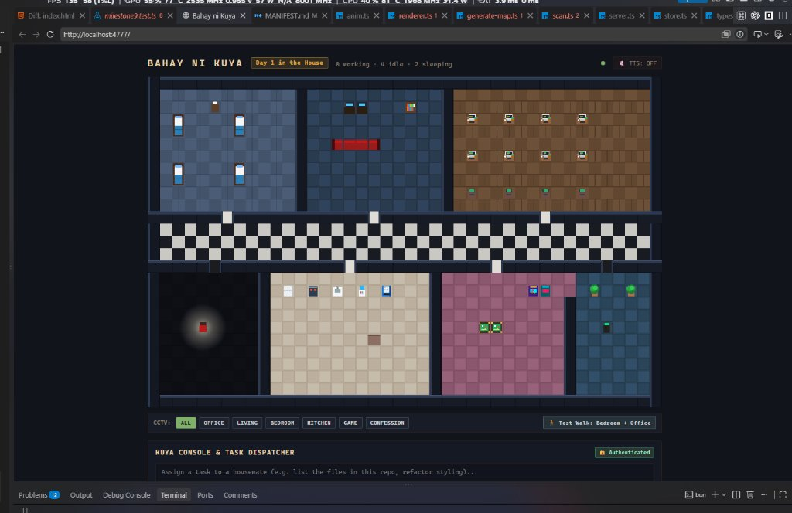
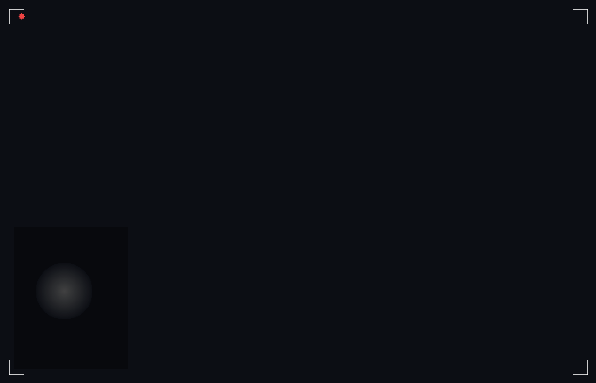
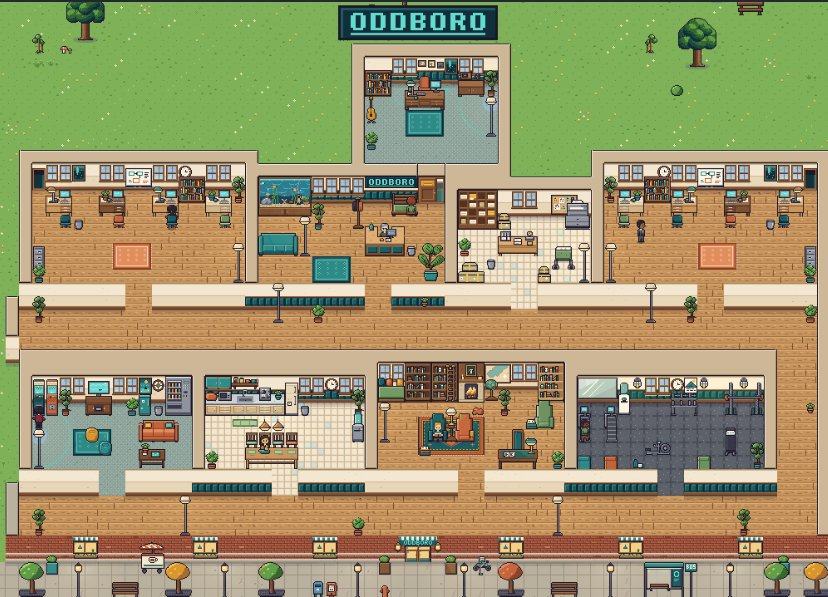
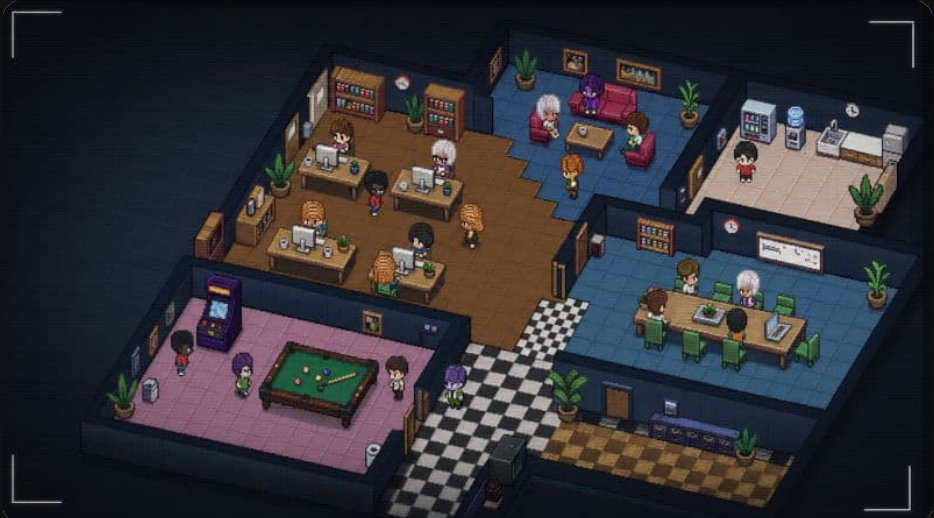

# Bahay ni Kuya — Visual & Screenshot Verification Guide

This directory documents the visual transformation of Bahay ni Kuya from a flat 2D diagram to a fully-realized pixel game matching the Oddboro (Apache-2.0) visual benchmark and raised 3/4 cutaway office reference.

---

## 1. Before vs. After Visual Comparison

### Before: Flat 2D Diagram

*Previous build: Flat monochrome rectangle placeholders, empty rooms, missing furniture, and plain colored geometric boxes.*

### After: Hand-Crafted Pixel Art Game (Oddboro Benchmark Quality)

*New build: Rendered via PixiJS with nearest-neighbor integer scaling, rich parquet oak wood and checkered marble floors, 16-mask bitmasked plaster wall caps, 2-tile tall north wall faces with windows, dense room props (bunk beds, sectional sofa, widescreen TV, 12 computer desks, pool table, arcade cabinets, kitchen stove and counters, gym treadmills and weights, solitary confession chair and spotlight), and authentic chibi pixel characters (opencode, codex, pi, omp, hermes).*

---

## 2. Benchmark References

### Oddboro Benchmark (github.com/New-Altitude/Oddboro - Apache-2.0)


### Raised 3/4 Cutaway Pixel Office Reference


---

## 3. Running the Visualizer

1. Start the Bahay ni Kuya Bun server:
   ```bash
   bun run start
   ```
2. Open your web browser to:
   ```
   http://localhost:4777
   ```
3. Run the automated full day-in-the-house simulation:
   ```bash
   bun run fake
   ```
4. Verify all tests:
   ```bash
   bun test
   ```
